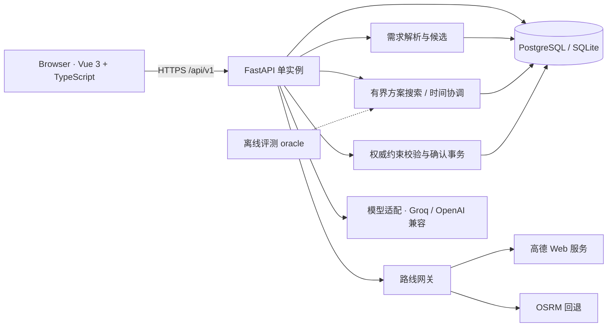

[](https://github.com/yuchangceng065-hub/tripcanvas-shitu/actions/workflows/ci.yml)

# 拾途杭州 · TripCanvas

面向杭州 1—3 日短途游的个人行程规划网页，使用 Vue 3 + TypeScript 和 FastAPI。支持真实地点搜索、步行 / 自驾接驳路线及地图时间轴编辑。首次打开是杭州西湖的可编辑示例行程。

当前执行范围、里程碑与验收标准见 [杭州版本执行计划](docs/hangzhou-plan.md)；已完成与未完成能力见 [能力清单](docs/capability-matrix.md)。现阶段已支持候选地点草案、单地点意图加入和局部路线调整；规则需求确认与模型分日排序已接通，多方案可在新建旅行中比较。

## 当前状态（2026-11-05）

- 线上前端：https://tripcanvas-shitu-melody.yuchangceng065.chatgpt.site/ ，Sites 静态托管，仅所有者可访问。
- 线上 API：https://tripcanvas-api.onrender.com/api/v1 ，Render Free 单实例；数据库为 Neon Free PostgreSQL。健康检查返回 `plannerMode=model`、`model=true`、`map=amap`、`routing=amap`、`storage=postgresql`。
- 线上已验收：注册登录、Bearer 会话、行程同步、版本记录、快照分享与撤销、高德地图与路线、地点搜索、停车接驳。
- 规划模式：线上已启用 Groq Free Tier 的 `openai/gpt-oss-20b`，支持真实模型分日排序与局部修改；规则草案仍可单独选择。
- 自动化：前端 81 项（含实际 Vue 组件交互）、后端 121 项测试通过，生产构建通过；GitHub Actions 运行测试、构建、离线评测与空库迁移；Postgres 17 兼容性工作流已跑通（迁移 + 完整后端测试）。最新记录见 `docs/verification.md`。

## 架构


- 模型只负责排序与局部编辑，路线、时间、必去与返程由服务端计算并复核。
- 外部调用有持久化预算、限速与有界缓存；失败明确返回，不静默换供应商。
- 前端为 Sites 静态托管，API 在 Render，数据库为 Neon PostgreSQL。

## 当前实现

- 桌面三栏旅行画布、手机端行程 / 地图 / 助手切换。
- 地图按后端能力切换：高德 JS API 2.0（GCJ-02，生产），无高德密钥时回退 Leaflet + OpenStreetMap（WGS84）。
- 步行路线使用高德步行；自驾按“步行回停车点 → 取车预留 → 驾车 → 停车预留 → 步行到景点”分段计算；连续景点共用停车点时车辆留在原处。
- 停车点在附近候选中推荐，名称或地址明显含内部 / 专用 / 校内等提示的候选不自动选用；用户可在“交通与停车”中确认，修改后先预览再保存。
- 地图底部显示路线查询时间与有效期（驾车 5 分钟、步行 24 小时），过期后给出一键重新计算。
- 日程切换、拖拽排序、按钮排序、跨日移动、时长编辑、地点增删与收藏。
- 必须保留 / 固定时间 / 解锁，时间冲突检测，固定返程检查；冲突显示地点、最早到达、固定时间与晚到分钟数。
- 规则建议（轻松一点、室内替换、晚出发、顺延）与模型局部编辑共用时间协调步骤：先缩短未锁定停留，再尝试重排或删减，变更逐项预览后确认。
- 本地持久化、不可变版本记录和恢复；行程摘要、JSON 和独立 HTML 卡片导出。
- 配套 FastAPI 账号、HttpOnly 会话、用户归属校验、版本同步、快照分享与撤销。
- 新建旅行向导：一句需求规则解析（日期、天数、人数、交通、节奏、兴趣、地点提及与返程时间）→ 真实地点候选确认 → 候选地点 → 规则或模型分日排序 → 道路核验 → 服务端确认事务保存。
- 新建候选步骤可标记“必去 / 可选”，使用“生成多方案 · 主动协调”比较少走路、充分游览、轻松休闲。有限搜索会尝试同日重排、跨日移动、建议范围内缩短停留及舍弃可选点；真实整日路线核验后展示指标，必去与固定返程不会被自动放松。详情见 `docs/alternatives.md`。
- 新增 P0 工具调用 Agent：`POST /planner/agent`，最多 6 步，模型只选工具，服务端跑路线/校验，方案仍需 confirm；暂未接前端。
- 草案保存与助手方案应用走 `/planner/confirm`：服务端重新计算道路、复核硬约束与锁定，版本冲突返回 409，冲突返回带修复选项的 422。
- 冲突修复先调用只读 `/planner/preview` 重算逐站时间、路线与剩余问题，用户再次确认才保存。预览失败可重试；最终确认失败保留结构化修复选项。固定预约保护日期与时段；返程要求核验实际车站、末日位置和最早到达。
- 需求卡支持每日步行预算：按高德分段路线累计步行接驳，超预算为硬冲突并给出删减选项；11:30—13:30 没有 40 分钟空档时给出用餐/休息提醒（警告不阻断保存）。
- 真实地点搜索：高德地点文本搜索（杭州行政区内），或 Photon（无高德密钥时）；搜索结果持久化到服务端地点目录，旅行快照保存服务端核实过的坐标。

## 未完成与已知边界

- 一句需求目前是规则解析：能提取日期、天数、人数、交通、节奏、兴趣、地点提及与返程时间，并搜索真实候选；复杂条件、主动推荐候选和自由表达仍有限，地点必须由用户确认。
- 新增最多三套真实路线方案比较；用餐 / 休息仍只有空档提醒，空余指标不等于已插入用餐安排。
- 草案与助手应用已走后端权威确认；手工编辑仍可直接保存为草稿，尚未统一所有编辑入口。
- 运行事件只回放已完成结果，不是逐阶段后台任务；没有数据库迁移体系（当前用 SQLAlchemy 自动建表）。
- 不支持公交地铁、多城市、实时导航、未来出行日交通预测；营业时间、门票、预约、停车可用性没有实时核验。
- 自驾假设车辆初始停在当天首站选定（或推荐）的停车点，不是从用户任意位置出发的门到门方案；景区内部通行与入场时间未覆盖。
- 高德搜索使用杭州行政区限制；无密钥时 Photon 使用周边经纬度框，边界结果需核对地址。
- 模型现使用 Groq 免费档，容量与限流以账户为准；达到限制会明确返回错误，不自动切换付费服务。规则草案仍可独立使用。
- 旅行卡片文件和摘要是独立副本，发送后不能远程撤销；服务端分享链接支持撤销。
- 费用为示例个人预算；图片是氛围配图，不是景点实景。

## 本地启动

需要 Node.js 22.12+（本次使用 Node.js 24）和 Python 3.12+。

```sh
npm ci
npm run dev
```

前端访问 http://127.0.0.1:5173 。本地体验无需地图或模型密钥：地图回退 Leaflet + OSM 瓦片，地点搜索走 Photon，路线走高德不可用时的 OSRM 实现（`backend/routing.py`）。

另开终端启动后端：

```sh
python3 -m venv .venv
.venv/bin/pip install -r backend/requirements.txt
.venv/bin/python -m uvicorn backend.app:app --host 127.0.0.1 --port 8000
```

后端启动时若项目根目录存在 `.env` 会自动读取（不覆盖已设置的环境变量），可放本地 `MODEL_*` 配置。后端启动后刷新前端，点右上角账号按钮注册。接口文档：http://127.0.0.1:8000/docs 。本地示例数据库创建在 backend/tripcanvas.db，不提交仓库；单元测试使用 SQLite。

## 配置

环境变量见 `.env.example`，通过运行环境注入后端，密钥不得使用 `VITE_` 前缀。

- 高德：`AMAP_WEB_KEY`、`AMAP_JS_KEY`、`AMAP_JS_SECURITY_CODE` 齐备且 `ROUTING_PROVIDER` 不为 `osrm` 时启用；`PUBLIC_API_ORIGIN` 为 API 的 HTTPS 地址，用于 JS 安全代理。
- 模型：OpenAI 兼容的 `MODEL_BASE_URL` + `MODEL_API_KEY` + `MODEL_NAME`，且 `PLANNER_MODE` 不为 `rules` 才会调用。当前线上 Groq 为 `auto`，本地示例仍默认 `rules`。
  - 当前已启用 Groq 免费档：`MODEL_BASE_URL=https://api.groq.com/openai/v1`、`MODEL_NAME=openai/gpt-oss-20b`，专用密钥变量为 `GROQ_API_KEY`。不会将旧的智谱 `MODEL_API_KEY` 发给 Groq。设置低推理强度且不返回 reasoning，仍由服务端校验 JSON 和业务约束。[Groq 官方参数](https://console.groq.com/docs/reasoning)。免费档实际额度以账户控制台为准；已完成真实 JSON 调用、线上模型草案和局部修改验收。
  - 智谱国内官方免费款：`https://open.bigmodel.cn/api/paas/v4`，型号 `glm-4.7-flash`；在 [API Keys](https://bigmodel.cn/usercenter/proj-mgmt/apikeys) 创建国内站密钥，不能混用其他供应商的 Key。官方[免费发布说明](https://www.zhipuai.cn/zh/news/148)与[模型文档](https://docs.bigmodel.cn/cn/guide/models/free/glm-4.7-flash)。账号限流以控制台为准，尚待用户密钥做真实验证。
  - Z.AI：地址 `https://api.z.ai/api/paas/v4`；免费档可用 `glm-4.7-flash`，`glm-5.1` 是付费旗舰（官方价 $1.4 / $4.4 每百万输入 / 输出 token）。
  - OpenRouter：地址 `https://openrouter.ai/api/v1`，模型 `z-ai/glm-5.1`（付费，没有 `:free` 变体）。
  - AIHubMix：地址 `https://aihubmix.com/v1`，模型 `coding-glm-5.1-free`；本账号试用额度已用尽，需充值或新账号。
  - 配置后先跑 `.venv/bin/python scripts/model-check.py` 验证密钥与 JSON 输出，再改 `PLANNER_MODE=auto`；密钥只放后端环境变量，不要提交。
- 坐标：内置地点保存原始 WGS84；高德地点保存 GCJ-02。进入高德算路前用官方坐标转换接口转换，原始坐标保留。
- 预算：`provider_usage` 表按日 / 月原子预留调用次数，默认 LBS 500/天、搜索 100/天、地图 500/天；达到预算返回 429，不自动升级付费。
- 反代：`backend/start.py` 以单 worker 启动并信任平台代理头（`forwarded_allow_ips` 可覆盖），使限流键取到真实客户端 IP。

跨源部署需要调整 `FRONTEND_ORIGINS`、HTTPS 会话及反向代理；推荐把前端 `/api` 代理到 Python 服务，保持同源。


## 数据库迁移

```sh
.venv/bin/python -m alembic upgrade head        # 空库或升级
.venv/bin/python -m alembic current             # 当前版本
```

- 基线版本 `backend/migrations/versions/`；CI 会在空 SQLite 上执行 `upgrade head` 并核对表结构与模型一致。
- 已经用 `create_all` 建过表的线上库首次接入时，先备份，再执行一次 `alembic stamp head`，不要重复建表。
- 本地开发仍会自动建表方便起步；后续 schema 变更以迁移文件为准。

## PostgreSQL

安装 Docker，并在未提交的 `.env` 中设置 `POSTGRES_PASSWORD` 后：

```sh
docker compose up --build
```

API 仍在 8000 端口，前端使用 `npm run dev`。不要将示例配置直接当作互联网生产环境配置。

## 校验

固定任务评测与真实模型冒烟必须分开记录，详见 [评测说明](docs/evaluation.md)。本次固定工程任务从 28/30 修复到 30/30；其中 10/10 可行规划任务成功、4 条负向任务未错误接受，模型调用为 0。

```sh
npm test
npm run build
.venv/bin/python -m pytest backend/tests -q
```

当前结果：前端 81 项、后端 121 项通过，`vue-tsc` 类型检查与 Vite 生产构建通过；CI 此外运行 `ruff check`（pyflakes 规则）、30 条离线评测与 Alembic 空库迁移。

浏览器验收（需本地 API + Vite + Chrome 调试端口）：`node scripts/browser-check.mjs`，脚本会跑完“一句需求 → 地点确认 → 草案 → 确认保存”，并拒绝在非本地 API 上创建测试账号。测试覆盖锁定保护、仅修改指定日期、时间冲突与顺延协调、中文输入法 Enter、地点意图、道路结构校验、分享快照、撤销、用户隔离、版本幂等、高德响应与预算。

## 目录

- `src/App.vue`：页面、助手、草案预览与应用、保存交互。
- `src/domain.ts`：行程类型、排程、规则建议、约束与差异。
- `src/routes.ts`：路线请求、响应校验、供应商 / 停车状态缓存。
- `src/coordination.ts`、`src/retiming.ts`：建议的时间协调与顺延计算。
- `src/composerKeyboard.ts`、`src/placeIntent.ts`：输入法按键与地点意图。
- `src/components/TripBuilder.vue`、`PlacePicker.vue`：新建需求与候选选择。
- `src/components/MobilitySettings.vue`：停车选择与预留时间。
- `src/components/TripMap.vue`、`AmapTripMap.vue`、`OsmTripMap.vue`：地图供应商切换与展示。
- `backend/app.py`：认证、旅行、分享、规划接口与使用预算。
- `backend/planning.py`：需求模型、候选排序、初稿构造与权威约束校验。
- `backend/requirements.py`：一句需求的规则解析（条件与地点提及）。
- `backend/amap.py`：高德地点、坐标转换、接驳路线与车辆状态。
- `backend/catalog.py`：Photon 搜索与地点目录。
- `backend/routing.py`：路线契约与 OSRM 实现。
- `backend/tests/`：后端自动化测试。
- `docs/`：执行计划、能力清单、验证记录与部署说明。

## 数据与署名

- 生产地图与路线：© 高德地图（GCJ-02）；地点搜索由高德提供。
- 回退模式：地图 © OpenStreetMap contributors（ODbL）；搜索由 Photon 提供；路线由 FOSSGIS / OSRM 提供。
- Logo 和助手插画为本项目原创 SVG/CSS；图标来自 Lucide（ISC）。
- 氛围照片来自 Unsplash 图片服务：
  - https://images.unsplash.com/photo-1470770841072-f978cf4d019e
  - https://images.unsplash.com/photo-1509042239860-f550ce710b93
  - https://images.unsplash.com/photo-1441974231531-c6227db76b6e
  - https://images.unsplash.com/photo-1511818966892-d7d671e672a2

## 部署

采用 Render Free + Neon Free，配置在 `render.yaml`，步骤见 `docs/render-neon-deployment.md`；公开部署信息（不含凭据）见 `docs/deployment.json`。前端为 Sites 静态托管，发布需按 Sites 工作流同步源码并构建，不能仅凭 GitHub push 认为前端已更新。云端要求 PostgreSQL，不允许临时 SQLite。前端已加入有限时长的唤醒等待、状态提示和手动重连；失败的写请求不会自动重发。

此前 Railway 部署被新账号试用限制阻止，不再作为首选。
