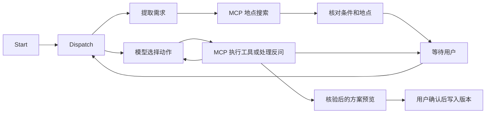

# 拾途 Agent 技术栈

新建行程里的「用 AI 对话规划」使用 LangGraph。页面按真实执行顺序显示节点和 MCP 调用，运行详情保留耗时与错误事件。此前创建的任务沿用原执行引擎。



- **LangGraph StateGraph** 负责节点编排和条件分支。地点、出行条件和次数预算由现有业务会话维护，图检查点记录执行位置与中断。用户补充时按原运行编号恢复，版本校验与幂等检查先于图执行。
- **PostgreSQL Checkpointer** 使用 `AsyncPostgresSaver` 和小型连接池，开发环境用持久 SQLite 检查点。等待节点只处理 `interrupt()` 和恢复值。正式保存通过独立的确认接口重新核验，重复确认只产生一个版本。
- **MCP Python SDK 1.x** 在每次运行中初始化真实 MCP 客户端，发现工具并通过进程内 Streamable HTTP 调用。工具绑定本次候选集合、起终点和交通方式。工具包括地点搜索、道路查询、核验、比较和修复。修复每个任务可调用一次，最多 10 个候选和 5 种整日路线，搜索时间上限 25 秒。地图调用仍由原有额度控制。
- **LangSmith SDK 与 pytest** 使用合成地图和脚本模型跑真实 HTTP 入口。程序分别验收重启后恢复与修复、拒绝错误候选、地图不可用时停止。判定覆盖路线可行性、返程、未确认写入和版本数量。报告包含已执行节点和工具摘要，可用相同夹具比较版本。线上图执行的第三方 tracing 显式关闭。

## 复现

```sh
.venv/bin/python scripts/demo_mcp.py
.venv/bin/python scripts/evaluate_agent.py --output /tmp/shitu-agent-report.json
.venv/bin/python -m pytest backend/tests/test_agent_graph.py -q
```

MCP 演示用独立进程与 stdio 连接，可发现 5 个工具、核验方案和拒绝越界地点。网页实际使用 Streamable HTTP，并调用已配置的地图服务。

评测默认在本地执行，使用合成道路和脚本模型。加 `--baseline` 可对比同一夹具版本的历史报告。已有 LangSmith 账号时，可在环境中设置 `LANGSMITH_API_KEY` 后显式加 `--upload`，将合成示例和实验结果写入 LangSmith。

## 能力概述

基于 LangGraph、PostgreSQL 和 FastAPI 编排多轮旅行规划 Agent，支持人工确认、检查点恢复和 SSE 执行轨迹。用 MCP 封装地点与道路工具及有界约束求解，使用 LangSmith SDK 和 pytest 回归验证候选边界、返程约束与写入幂等。
