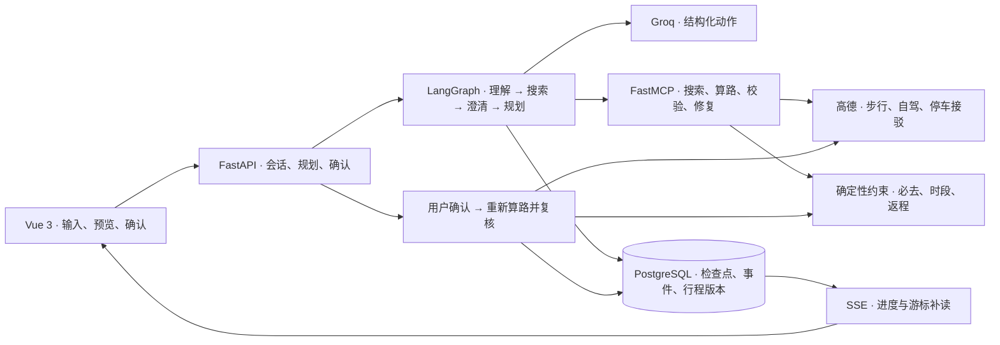

# 拾途杭州 · 系统架构与关键实现

拾途把「一句话想去哪」变成可核验的杭州行程。用户补充条件、确认地点，Agent 查询道路并生成草案。用户确认后，服务端重新核验并写入行程版本。

## 会话编排与任务续跑

需求缺字段、地点有歧义，或者需要用户确认时，用 `interrupt()` 挂起。检查点按 `runId` 持久化，回复时校验会话版本，再用 `Command(resume=…)` 续跑同一任务。模型给出结构化动作，工具通过进程内 Streamable HTTP 调用 MCP。浏览器断线用 SSE 游标补读事件，继续执行依靠数据库检查点和会话版本。[状态图](../backend/agent_graph.py) · [工具实现](../backend/agent_mcp.py) · [重启与续跑测试](../backend/tests/test_agent_graph.py)

## 确认事务与幂等保存

确认接口用 `baseRevision` 检查版本，用 `runId` 与草案指纹核对规划结果，再重新算路并检查硬约束。并发首次写入由 PostgreSQL 主键冲突处理收敛。相同快照返回幂等重放，行程、版本和唯一确认事件在同一事务提交。压测的 12 轮、864 次确认均只在每轮写入一次。[确认接口](../backend/routers/planner.py) · [事务实现](../backend/store.py) · [真库压测](postgres-contention.md)

## 轨迹评测与故障验收

过程检查工具白名单、候选范围、步骤预算、事件顺序和恢复证据。结果检查草案、必去地点、天数和写入状态。15 分钟安排两个必去地点的实测样本最终没有写入，但过程多尝试一次修复并请求放宽条件，评为 `result_only`。五类样本中四条线上采集、一条隔离故障注入，过程 **4/5**、结果 **5/5**。[评测器](../backend/trajectory_eval.py) · [真实任务集](../fixtures/evaluation/real-tasks/v1.json) · [评测报告](evaluation.md#脱敏真实任务与版本对比)
