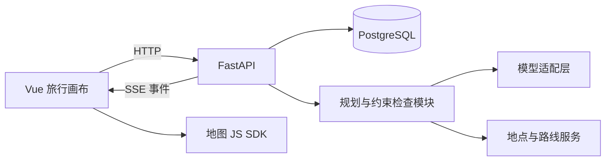

# 拾途 TripCanvas：产品与技术设计大纲

版本：v1.0 · 2026-11-03  
阶段：设计，尚未开始产品开发  
目标：个人可使用、可公开体验、适合全栈实习求职的 AI 旅行规划产品  
协作方式：AI 协助架构、实现、联调、测试与文档；开发者参与需求取舍、体验反馈与核心代码实践。

## 1. 产品定位

一句话：把出行想法变成可以在地图上编辑、能检查约束、可以局部调整的短途旅行计划。

首批用户是规划周末出游、城市漫游和 1—3 天短途旅行的个人用户。产品价值集中在三个问题：收藏的地点如何排在一起、行程是否安排得下、修改一部分时如何保留满意的安排。

首版面向中国大陆单城行程，时间统一按 Asia/Shanghai 处理；每天约 4—6 个主要活动。每份计划使用明确的交通方式，先验证步行与驾车接口，再确定正式支持范围。城市间交通作为用户给定的到达、返程约束，不接入票务预订。

两周是协作开发的目标窗口，按每天约 3—4 小时估算。地图接口权限、模型接入和实际联调结果会影响进度；第 1 天验证外部依赖，第 6 天验收完整主流程。

## 2. 核心用户故事

示例输入：“周末去杭州两天，两个人，喜欢咖啡和拍照，不想太赶，周日下午五点前到车站。”

1. 系统提取城市、日期、偏好、节奏和返程要求，展示可编辑的条件卡片；缺少具体日期或车站时请用户补充。
2. 查找真实地点，展示名称、地址与地图位置；同名地点需要消歧。
3. 根据地点、停留时间、交通估时和约束生成行程草案。
4. 用户在地图和时间轴上查看，拖拽调整顺序。
5. 用户锁定午餐与返程安排，输入“第二天下午改成室内活动”。
6. 系统生成修改预览，重新检查路线和时间，展示新增、删除、移动的活动。
7. 用户确认后保存新版本；可以恢复旧版本，或发布一个可撤销的只读分享链接。

## 3. 两周功能边界

### P0：交付必须具备

| 模块 | 功能范围 | 可见成果 |
| --- | --- | --- |
| 账号与旅行 | 基础登录、创建旅行、保存、打开、删除；每位用户只能编辑自己的旅行 | 能持续管理个人计划 |
| 需求卡片 | 城市、具体日期、起止地点、每日时间范围、兴趣、节奏、交通方式 | 模型理解结果可检查、可修改 |
| 地点管理 | 搜索地点、消歧、加入候选清单、查看地址 | 推荐地点落到真实地图位置 |
| AI 草案 | 从确认的地点集合中生成结构化安排 | 地图和每日时间轴同步呈现 |
| 可视化编辑 | 增删、调整停留时长、同日排序、跨日移动 | 修改后重新计算受影响路线 |
| 锁定与局部修改 | 保留指定地点或固定安排，生成可审核的修改方案 | 用户确认后生效 |
| 行程检查 | 时间重叠、交通时间、每日结束时间、固定返程条件 | 冲突定位与明确解释 |
| 版本与分享 | 修改预览、版本保存、恢复旧版、只读分享、撤销分享 | 可撤销、可追溯的个人计划 |

### P1：主流程稳定后按剩余时间选择

- 情景分支：复制当前计划，创建“晚出发一小时”“偏室内”等备选版本并比较。
- 攻略文字导入：提取地点，匹配真实 POI，由用户确认后加入候选清单。
- 行程图片导出：导出自有卡片布局；地图截图或导出遵循地图服务允许的方式。
- 手机体验细化：底部抽屉、触摸排序和路线导航入口。

### P2：后续产品迭代

- 攻略截图识别、图片辅助理解。
- 有效预报范围内的天气提醒与备选方案。
- 共享旅行的评论、投票与共同编辑。
- 更完整的费用资料、路线偏好和长期个人偏好设置。

首版预算是用户输入和明确标注来源的估算汇总，不作为能够保证的价格约束。缺少营业时间或费用数据时显示“待确认”，不补造事实。

## 4. 差异化设计

### 4.1 地图与时间轴联动

- 行程卡片与地图标记使用同一 activity_id。
- 点击卡片定位地图；点击地图标记打开卡片。
- 按日期分配路线颜色，显示访问顺序。
- 拖拽后立即更新界面，并显示“正在重新计算”；计算完成后同步时刻与冲突。
- 快速连续修改只接纳最新草案对应的计算结果，避免旧响应覆盖新计划。
- 支持按钮式上移、下移和跨日移动，保证不依赖拖拽也能操作。

### 4.2 保留约束的局部编辑

提供两种明确的锁定行为：

- “必须保留”：保留地点，允许调整日期或时段。
- “固定安排”：保留地点、日期及开始结束时间，例如预约午餐。

返程到站时间属于独立的硬约束。模型提出修改后，程序对整个候选计划进行检查；冲突时提供原因，用户可以自行修改约束。系统不静默放松硬约束。

修改预览展示新增、移除、移动、时间变化，以及根据可用路线数据计算的交通时间变化。预计时间始终标明为估算。

### 4.3 行程检查

| 条件 | 数据来源 | 判断方式 |
| --- | --- | --- |
| 同一用户活动时间重叠 | 已保存的活动时间 | 程序比较时间区间 |
| 两站间交通时间不足 | 路线接口估时 + 可配置缓冲 | 预计抵达时间与下一活动比较 |
| 超出每日时间范围 | 用户确认的每日起止时间 | 程序校验 |
| 固定安排或返程被破坏 | 用户锁定条件 | 校验地点、日期、时刻 |
| 安排过密 | 游览、交通、休息时长 | 展示分项及可调整阈值 |
| 营业时间冲突 | 可靠来源或用户确认信息 | 有数据才检查，无数据标记未知 |

系统区分“存在冲突”“已检查通过”“资料不足”三种状态。已检查通过仅表示在现有输入与估算下通过检查。

### 4.4 版本与分支

保存后的版本不可变，草案可以编辑。恢复旧版会创建一个新版本，保留历史。

P0 展示当前计划与修改建议的差异；P1 再提供两个独立情景分支的并排比较。比较基于活动、时间与数据来源，不给出没有计算依据的综合分数。

## 5. 页面大纲与交互规范

### 页面 A：我的旅行

- 新建旅行入口、最近计划、旅行日期和城市。
- 首次使用提供明确标注的示例计划。
- 新建输入框支持自然语言，随后确认结构化需求。
- 初始草案生成前确认必要字段，不强迫填写所有偏好。

### 页面 B：旅行画布（核心）

桌面布局：左侧每日时间轴，中间地图，右侧 AI 调整面板；顶部是日期切换、版本、保存与分享。

时间轴卡片包含地点、到达时间、停留时长、交通衔接、锁定状态。地图标记与卡片双向高亮。

AI 面板展示实际运行阶段、待补充条件、修改方案和确认按钮。常用指令以快捷入口呈现，如“留出午休”“减少安排”“只调整今天”。

生成状态包含：等待、查找地点、查询路线、安排时间、检查约束、待确认、完成、失败。每个状态来自服务端事件。

### 页面 C：分享页

- 手机优先布局，展示日期、路线、地点与时间安排。
- 分享绑定用户明确选择的版本；之后的编辑不会自动公开。
- 默认排除住宿详细位置、私人备注及个人标识；私密位置对应的坐标、地图标记和关联路线段同步移除，分享预览中明确可见内容。
- 分享者可撤销；链接不是搜索引擎收录入口。
- 复制他人公开计划到自己的账号可作为 P1。

### 视觉原则

暖白背景，深绿或海蓝强调色，地图作为主要视觉元素。采用清楚的日期层级、轻量地点卡片、充足留白与少量动效。颜色以外同时用文字或图标表达冲突状态。

## 6. 技术架构

| 层次 | 选型 | 职责 |
| --- | --- | --- |
| 前端 | Vue 3、Vite、Vue Router、Pinia | 页面、状态和交互 |
| 语言 | TypeScript 基础类型与接口 | 明确活动、约束和事件结构；避免不必要的复杂泛型 |
| 样式 | Tailwind CSS、自定义业务组件 | 保持面向个人的统一视觉 |
| 地图与排序 | 高德 JS API、SortableJS | 地点、路线、拖拽排序 |
| 后端 | FastAPI、Pydantic、HTTPX | 接口、校验、外部 API 调用 |
| 存储 | PostgreSQL、SQLAlchemy、Alembic | 业务持久化与迁移 |
| AI | 支持结构化输出的模型、Python 工具函数 | 意图提取、候选筛选、修改建议 |
| 验证 | pytest、Playwright | 核心规则、接口与用户流程 |
| 交付 | Docker Compose | 一致的本地与演示环境 |

基础规划流程采用显式 Python 编排。若后续需要复杂的暂停恢复与多分支执行，再评估 LangGraph。地图模块、模型模块与业务模块通过适配器解耦。

SSE 用于服务端到客户端的阶段与结果事件，用户编辑仍通过 HTTP 请求提交。进程内运行器限制并发，运行记录写入数据库；服务重启后将未完成任务标记为中断，用户可重试。首版不承诺跨进程断点续跑。

## 7. AI 规划流程

### 初次生成

自然语言 → Pydantic 校验需求 → 用户补全关键条件 → 查询并确认 POI → 获取必要路段 → 生成候选顺序和停留时长 → 程序计算日程并检查 → 展示草案。

模型只能引用服务端提供或已确认的 POI ID；经纬度、地点地址、路线估时来自数据服务。模型可以提出兴趣匹配理由，但不能凭空写入地理和价格事实。

程序按地理邻近和兴趣进行候选筛选，以明确的时间约束检查候选安排；首版是启发式规划，不宣称全局最优。如果约束互相冲突，返回冲突和可选调整方向。

### 局部修改

当前版本 + 用户指令 + 锁定条件 → 生成结构化操作 → 应用到临时草案 → 获取变化路段 → 全量约束检查 → 生成差异预览 → 用户确认 → 保存新版本。

允许的操作包括 add_activity、remove_activity、move_activity、replace_place、update_duration。所有操作通过 Pydantic 模型、活动归属检查和锁定规则检查。修改硬约束使用独立的用户操作。

模型输出校验失败时允许一次修复尝试；再次失败则返回可理解的错误，保留原计划。外部接口失败和模型输出失败分别记录。

## 8. 数据结构大纲

首版采用“小型旅行整体快照”存储：每个版本的 JSONB 快照包含 days、activities、constraints 和计算结果。活动使用稳定 ID，便于比较版本和地图联动；未来需要跨旅行分析时再将活动拆为独立关系表。

| 实体 | 主要字段 | 用途 |
| --- | --- | --- |
| users | id、账号、密码摘要、创建时间 | 身份与数据归属 |
| trips | id、owner_id、城市、日期、current_version_id、revision | 旅行索引与并发控制 |
| trip_versions | id、trip_id、parent_id、snapshot、change_summary | 不可变版本与差异来源 |
| places | provider、provider_id、名称、地址、坐标、来源、获取时间 | 已确认的地点资料；按服务条款决定缓存范围 |
| plan_runs | id、owner_id、trip_id、base_version_id、状态、输入、输出、错误、用量 | AI 运行与修改建议 |
| plan_events | run_id、seq、事件类型、载荷、时间 | 进度推送与记录恢复 |
| route_cache | 起终点、交通方式、时间桶、结果、获取及过期时间 | 遵循供应商规则复用路线结果 |
| share_links | trip_id、version_id、token_hash、可见字段、过期和撤销时间 | 只读分享 |

所有来源保留供应商和获取时间。前后端地图使用一致的坐标体系；接入其他地理数据时显式转换，不直接混用。

## 9. API 大纲

统一前缀 /api/v1。以下为资源契约草案，实施时输出 OpenAPI 并对齐前端类型。

| 方法与路径 | 功能 |
| --- | --- |
| POST /auth/register、/auth/login；POST /auth/logout | 基础账号与会话 |
| GET/POST /trips | 列表、创建旅行 |
| GET/PATCH/DELETE /trips/{id} | 读取、更新元信息、删除 |
| GET /places/search | 地点搜索与候选信息 |
| POST /trips/{id}/runs | 发起生成或局部修改 |
| GET /runs/{id} | 查询运行状态与结果 |
| GET /runs/{id}/events | 订阅或补取 SSE 事件 |
| POST /trips/{id}/validate | 检查手动编辑的草案 |
| POST /trips/{id}/versions | 提交已确认的手动草案 |
| POST /runs/{id}/apply | 确认 AI 修改方案 |
| GET /trips/{id}/versions | 读取版本列表 |
| POST /trips/{id}/versions/{version_id}/restore | 基于旧版创建新版本 |
| POST /trips/{id}/shares；DELETE /shares/{id} | 创建及撤销分享 |
| GET /public/shares/{token} | 读取授权公开的版本内容 |

写入携带 base_revision，版本已变化时返回 409，要求重新生成或确认，避免覆盖新编辑。确认操作携带幂等键，重复提交返回同一结果。

SSE 事件有运行内单调递增的 seq；客户端去重并按游标补取。读取运行、事件、版本都校验用户归属。分享访问只读取预先筛选的可见快照。

## 10. 可靠性与外部数据

- 前端乐观更新失败后回滚或保留明确标记的未保存草案。
- 地点、路线和模型调用设置超时、并发上限及有限重试；不无限重试。
- 路线请求失败显示未知或带时间标记的可用旧估算，不填成零分钟。
- 只重查发生变化的相邻路段；缓存键包含模式和影响估算的时间条件，并遵循供应商存储规则。
- 用户输入中的日期、人数、预算范围与停留时长均经过校验。
- 模型与 Web 服务密钥保留在服务端；浏览器地图 Key 按供应商要求限制使用范围。
- 演示账号有模型调用额度，公开接口限流；日志不包含密钥和密码。
- 删除旅行后撤销其分享，后台清理关联运行与历史数据。

第 1 天核验地图服务账号能否使用地点与路线能力、配额和实际响应。若关键 API 无法使用，可用明确标记的固定数据推进交互开发，但正式验收须说明尚未接通的数据能力。

## 11. 两周里程碑

| 时间 | 工作 | 验收门槛 |
| --- | --- | --- |
| 第 1 天 | 核验 API、定页面与契约、建立项目和部署骨架 | 可以查询真实地点并取得至少一条路线 |
| 第 2—3 天 | 登录、旅行保存、候选地点、地图和时间轴 | 手工创建的计划能保存并重新打开 |
| 第 4—6 天 | 意图解析、生成、阶段反馈、草案校验 | 输入需求到确认保存完整跑通 |
| 第 7—9 天 | 锁定、局部修改、拖拽、差异预览 | 指定变更生效，锁定条件保持 |
| 第 10—11 天 | 版本恢复、分享、移动端主要布局 | 可恢复旧版、撤销分享，手机可查看 |
| 第 12 天 | 固定场景测试、错误处理、调用统计 | 核心场景和失败流程可复现 |
| 第 13—14 天 | 部署验证、体验修复、README、录屏、简历 | 在线地址与交付材料齐全 |

进度落后时，先延后 P1；保留地图联动、锁定局部编辑、约束检查和可靠保存。第 12 天后仅修复与打磨。

## 12. 验收与评测

### 必须通过的工程场景

1. 创建旅行并刷新后，计划内容与版本保持一致。
2. 地图与时间轴选中同一活动，顺序一致。
3. 拖动活动后，受影响路段更新，旧请求不会覆盖新编辑。
4. AI 修改不能删除“必须保留”的地点，不能移动“固定安排”的时间。
5. 明确的时间冲突会被检测并定位；未知路程不被当作检查通过。
6. 重复确认一次修改只产生一次有效提交；旧版本提交得到冲突响应。
7. 模型或地图失败时，已有计划仍能读取，失败状态可见。
8. 分享页只包含授权字段；撤销后新的读取请求被拒绝。
9. 用户不能访问其他用户的私人旅行、运行事件和历史版本。
10. 恢复旧版保留原有历史，并创建新版本。

### 固定 AI 评测集

计划建立约 30 个场景，覆盖普通规划、必要信息缺失、同名地点、锁定修改、返程冲突和不可满足约束。调试样本与最终评测样本分开。

记录：需求字段提取正确率、结构化输出通过率、锁定条件遵循率、人工标注修改任务完成率、错误计划接受次数、端到端耗时和模型用量。结果同时报告样本数、模型版本和测试配置。

锁定遵循率指已应用修改中没有违反锁定条件的比例；还需报告修改完成率，避免以拒绝所有修改换取表面上的高遵循率。测试规则本身使用程序断言，模型判断与人工判断分开。

## 13. 仓库与协作方式

建议目录：frontend/、backend/、docs/、fixtures/、tests/ 与 compose.yaml。fixtures 标注示例来源及模拟字段；API 密钥用环境变量配置。

每个开发模块交付可运行结果、必要测试、简短设计说明和一个适合开发者亲手修改的练习。以用户可见流程拆分提交，例如“创建旅行”“生成草案”“调整当天安排”，让代码历史和产品进展对应。

## 14. 求职展示与交付物

项目名称：拾途 TripCanvas｜AI 旅行规划与可视化编辑平台。

完成后可用的简历描述模板：

- 基于 Vue 3 与 FastAPI 开发个人旅行规划应用，实现地点搜索、AI 行程生成、地图与时间轴联动及移动端分享。
- 设计基于结构化操作与版本校验的局部编辑机制，支持固定安排保护、变更预览和版本恢复。
- 结合地点与路线服务实现时间冲突和返程约束检查，区分外部数据、计算结果与待确认信息。
- 在 [N] 个固定场景中验证 [实测指标]，并记录生成耗时、修改成功率和模型调用用量。

功能描述只保留实际完成部分，数字由测试报告提供。根据实际协作情况如实说明 AI 辅助开发，并能解释与修改核心实现。

交付清单：在线体验地址、代码仓库、环境示例、数据库迁移、示例计划、架构图、API 文档、评测记录、90 秒演示视频和简历项目描述。

演示脚本：输入周末需求 → 生成地图和时间轴 → 锁定午餐与返程 → 用一句话调整下午 → 查看冲突与差异 → 确认并撤销 → 手机打开只读分享。

## 15. 官方参考资料

以下来源用于技术选型；具体依赖版本、接口可用性与配额在开始实现时再次核验。

- [Vue 官方工具指南](https://vuejs.org/guide/scaling-up/tooling.html)：Vue 与 Vite 项目工具。
- [FastAPI 官方功能说明](https://fastapi.tiangolo.com/features/)：接口、OpenAPI 与数据校验。
- [高德地点搜索](https://lbs.amap.com/api/webservice/guide/api-advanced/search)：地点查询、地址及坐标；具体权限以账号为准。
- [高德路径规划](https://lbs.amap.com/api/webservice/guide/api/direction)：路线相关能力。
- [高德 JS API 安全密钥](https://lbs.amap.com/api/javascript-api-v2/guide/abc/jscode)：浏览器地图接入配置。
